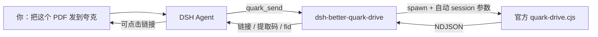

# dsh-better-quark-drive

> 让 DeepSeek Harness 里的 AI **一句话就能操作夸克网盘**：上传 + 生成分享链接一步到位，搜索 / 浏览 / 转存 / 下载全部工具化。

<p align="left">
  
  
  
  
  
</p>

---

## 这是什么

`dsh-better-quark-drive` 是 [DeepSeek Harness](https://github.com/) 的 cordis 插件：它把夸克网盘官方 CLI（`quarkclouddrive/scripts/quark-drive.cjs`）包装成 **12 个 AI 友好的工具**。

不重写协议、不落地凭证——只做三件让模型少犯错的事：

1. **把 3 步并成 1 步**：`quark_send` = 上传 → 分享 → 返回链接，模型不必拆成三次调用。
2. **把机器输出变成模型输入**：CLI 说 NDJSON（`progress`/`list`/`result`/`artifact`），插件只回一段紧凑的 Markdown 表格 + 可直接复用的 `fid`。
3. **把错误码变成下一步**：`14001`、`32003`、`-403` 这类返回值，插件会翻译成「该怎么改参数」的提示，而不是把原始 JSON 丢给模型猜。



---

## 为什么不是直接让 AI 调 CLI

| 裸 CLI | 本插件 |
| --- | --- |
| 每条命令都要 `--session-input` / `--session-id`，模型容易瞎编 | 插件按 DSH 会话自动生成并复用 |
| 输出是 NDJSON 流，`result` 常被 `list` / `progress` 淹没 | 解析成单一对象 + Markdown 表格 |
| 上传要 2 次调用才拿到链接（upload → share → 手抄 fid） | `quark_send` 一次完成 |
| `14001 upload dir blank` 需要人判断「要不要传根目录」 | 自动回落根目录，并在结果里明说 |
| `notice.text` 容易被忽略（合规提示丢失） | 每条结果原样附在末尾 |
| 超时、授权过期只会卡住 | 明确报错 + 可执行的修复步骤（`quark_setup`） |

---

## 安装

### 前置：先有官方 CLI

插件不自带夸克 API 实现，需要本机已有 `quarkclouddrive` 的 CLI：

```bash
# 官方 skill 放在下列任一位置即可被自动发现
#   $DSH_HOME/skills/quarkclouddrive/
#   ~/.agents/skills/quarkclouddrive/
#   ~/.claude/skills/quarkclouddrive/
bash scripts/install.sh      # 安装 / 更新 CLI 并完成登录
```

找不到 CLI 时，任何工具都会返回安装指引，而不是抛栈。

### 方式一：DSH 插件（推荐）

把本仓库放进 DSH 的插件搜索路径，或直接在 profile 里安装：

```bash
# 在 DSH profile 目录下
pnpm add dsh-better-quark-drive
```

`package.json` 已经声明了 `dsh.install`（tarball / zip / git）与 `dsh.bundle.patch`，DSH 会读取 [`cordis.patch.yml`](./cordis.patch.yml) 自动插入插件行。

### 方式二：本地开发 / 私有安装

```bash
git clone https://github.com/shimiei/dsh-better-quark-drive.git
cd dsh-better-quark-drive
npm run smoke          # 离线自检，不需要网盘账号
npm run smoke:live     # 额外验证 CLI 与授权（只读 get-user-info）
```

然后在 profile 的 `package.json` 里 `link:` 到该目录（或 `pnpm add file:../dsh-better-quark-drive`），重启 DSH 生效。

### 方式三：只改配置

已经装过插件的话，只想调整行为——改 `cordis.patch.yml` 里的 `config`，重启即可，无需重装：

```yaml
- insert:
    - id: better-quark-drive
      name: 'dsh-better-quark-drive'
      config:
        shareExpireDays: 30   # 默认分享 30 天
        shareUrlType: 2       # 默认私密链接（带提取码）
```

---

## 工具清单

| 工具 | 作用 | 典型触发语 |
| --- | --- | --- |
| `quark_send` | **上传 + 分享**，返回链接、提取码、有效期 | 「把这个文件用夸克发给我」 |
| `quark_upload` | 只上传，返回 `fid` | 「先存到网盘里」 |
| `quark_share` | 已有 `fid` → 生成分享链接 | 「把那个文件夹分享出去」 |
| `quark_search` | 关键词搜索，返回名称/大小/时间/fid | 「找我网盘里那份报告」 |
| `quark_browse` | 列出目录直接子项 | 「我网盘里都有什么」 |
| `quark_mkdir` | 新建文件夹 | 「建个 2026 归档 文件夹」 |
| `quark_move` | 移动文件到指定目录 | 「把这些都挪到归档」 |
| `quark_saveas` | 转存别人的分享链接（支持提取码） | 「这个链接帮我转存」 |
| `quark_download` | 下载到本地目录 | 「把那个 PDF 下下来」 |
| `quark_whoami` | 会员类型 / 容量占用 | 「网盘还剩多少空间」 |
| `quark_setup` | 环境检查、安装脚本、登录指引 | 「夸克怎么用不了」 |
| `quark_help` | 工具速查表 | 「你有哪几个夸克工具」 |

`fid` 是插件里唯一需要传递的「中间变量」：`search` / `browse` / `upload` 都会返回它，`share` / `move` / `download` 都吃它。模型不需要记住格式，照抄即可。

---

## 一次典型对话

```
你：把 D:\reports\q3.pdf 传到夸克，给我个 7 天的链接

AI：quark_send({ paths: ["D:\\reports\\q3.pdf"], expireDays: 7 })

已上传并生成分享链接 ✅
- q3.pdf（2.4 MB）
链接：https://pan.quark.cn/s/xxxxxxxx
链接类型：公开链接 ｜ 有效期：7 天
fid：209a7f1e…
```

分享有效期与链接类型都是入参，也可以固化成插件默认值：

| `expireDays` | 含义 |
| --- | --- |
| `0` | 永久有效 |
| `1` / `7` / `30` / `60` / `100` / `180` | 对应天数（CLI 的 `--expired-type` 枚举） |

`urlType: 2` 时服务端会自动生成提取码，插件把 `passcode` 一并返回。

---

## 配置

| 键 | 默认值 | 说明 |
| --- | --- | --- |
| `enabled` | `true` | `false` 时整套工具下线 |
| `cliPath` | `''` | 留空则自动发现 `quark-drive.cjs` |
| `shareUrlType` | `1` | `1` 公开，`2` 私密（带提取码） |
| `shareExpireDays` | `7` | 分享默认有效期（天），`0` = 永久 |
| `timeoutMs` | `180000` | 普通命令超时 |
| `uploadTimeoutMs` | `1800000` | 上传 / 下载超时 |
| `maxRows` | `20` | 列表类工具单次最多回给模型多少行 |

环境变量 `DSH_QUARK_CLI` / `QUARK_DRIVE_CLI` 也会被当作 CLI 路径候选。

---

## 设计要点

- **默认不猜目录**：`parentFid` 是选填参数，插件不会替你发明一个目录。只有 CLI 自己报 `14001 upload dir blank`（本机没配默认上传目录）时，才会重试一次网盘根目录，并在结果里写明「本次已上传到根目录」。
- **一次重试，不掩盖失败**：除上述情形外不做静默重试；失败就带着提示抛出来。
- **`notice.text` 一定透出**：官方 CLI 的提示文本（升级/会员/合规）逐字附在结果末尾，不会被摘要吞掉。
- **启动不依赖外部状态**：插件挂载时只注册工具，不探测网络、不读 token；环境问题延后到第一次调用。

细节实现见 [`docs/design.md`](./docs/design.md)。

---

## 隐私与安全

- 插件**不读取、不缓存、不上传**任何凭证；登录态由官方 CLI 自己维护。
- 日志只输出「CLI 是否找到」「注册了几个工具」，不打印账号标识、文件路径或 token。
- 仓库内的示例链接、`fid`、路径均为占位符；测试脚本使用临时会话 id。
- 除非显式 `urlType: 2`，生成的链接是公开链接——**别把公开链接贴到公开场合**。

---

## 开发

```bash
npm run smoke        # 12 个工具 spec 校验 + 配置归一化 + CLI 发现
npm run smoke:live   # 追加一次真实只读调用（get-user-info）
```

`scripts/smoke.mjs` 在 DSH 之外运行时用内置的 `defineTool` 兼容层，因此在任何 Node ≥ 18 环境都能跑，不会污染宿主。

目录结构：

```
lib/cli.js       # CLI 发现、spawn、NDJSON 解析、错误 → 提示
lib/tools.js     # 12 个 defineTool 规格与业务编排
lib/format.js    # 体积/时间/表格/markdown 渲染
lib/index.js     # cordis 入口（inject: ['tools']）
cordis.patch.yml # 插件行与默认配置
```

---

## 兼容性

- DSH：`dshTarget: 0.2.0-rc.2`，依赖 `@deepseek-ai/dsh-tools`（宿主注入）。
- 官方 CLI：`quarkclouddrive` ≥ 1.0.x（`quark-drive.cjs`）。
- Node：≥ 18（ESM + top-level await）。

## License

[MIT](./LICENSE) © dsh-better-quark-drive contributors

> 本项目只封装命令行调用方式，不包含夸克网盘服务端代码与任何账号数据；请遵守夸克网盘的服务条款。
